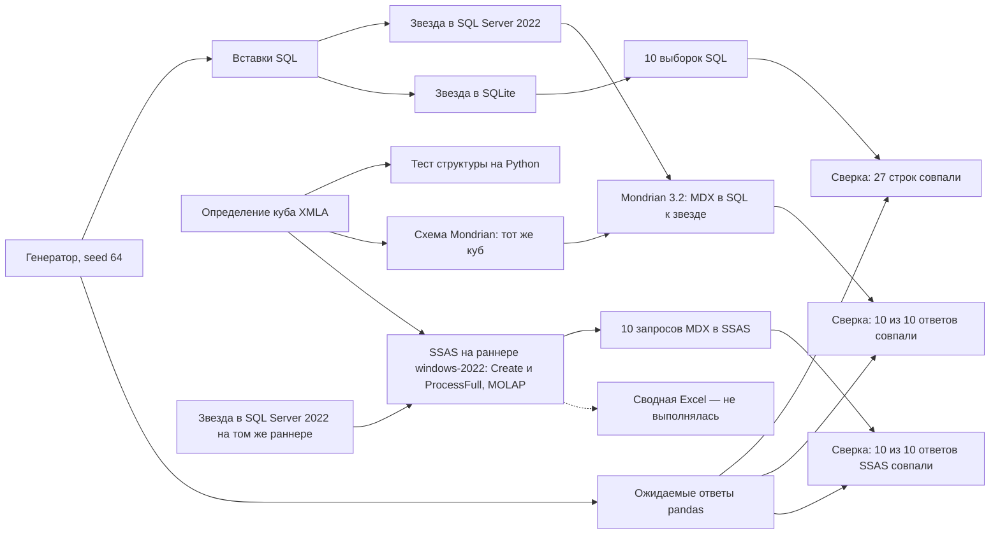

# Учебный куб продаж SSAS и запросы MDX — конспект

## 1. Зачем

Обещание — освоить MDX на учебном кубе SSAS (SQL Server Developer Edition) поверх витрины продаж: звезда в MS SQL, многомерный куб с измерениями «дата», «товар», «клиент» и иерархиями, 10–15 запросов MDX (срезы, YTD, ParallelPeriod, ранжирование) и подключение Excel к кубу.

Итог одной фразой (из [BRIEF](BRIEF.md)): Звезда продаж загружается в SQL Server 2022 и построчно совпадает с исходными данными; куб с тремя иерархиями описан в XMLA, создан и полностью обработан (ProcessFull, хранение MOLAP) в SSAS 2022 Multidimensional на временном раннере GitHub windows-2022; все 10 запросов MDX исполнены службой SSAS без правок текста, и ответы совпали с ожидаемыми, посчитанными двумя независимыми способами (pandas и SQLite); раньше те же запросы исполнены на заменяющем движке Mondrian 3.2; Excel к кубу не подключён.

Главное, что нужно помнить: **куб работал в настоящем SSAS, но один раз и на временной машине**. Своего сервера SSAS у проекта нет. Workflow GitHub Actions арендует на 7 минут чистую Windows-машину GitHub (раннер `windows-2022`), ставит на неё SQL Server 2022 Developer с Analysis Services и проходит всю цепочку: загрузка звезды, создание куба, обработка, 10 запросов MDX, сверка. Машина после этого удаляется, а журналы и ответы сервера сохранены в репозитории. Запуск 21.11.2026 прошёл с первой попытки. До этого запросы исполнял заменяющий движок Mondrian 3.2; эта проверка осталась в CI. Excel к кубу не подключался.

## 2. Задача простыми словами

Есть продажи: кто, когда, какой товар купил, сколько штук и на какую сумму. Аналитику нужно быстро отвечать на вопросы вроде «какая выручка у категории Office в 2025 году» или «насколько март этого года хуже марта прошлого». Для этого продажи раскладывают в «звезду» — таблицу фактов и справочники, — а поверх неё строят многомерный куб, где каждый ответ — это ячейка на пересечении года, товара и клиента. Запросы к кубу пишутся на языке MDX. Чтобы потом проверить ответы куба, заранее посчитаны правильные ответы другим способом.

## 3. Как устроено



Сплошные стрелки — то, что реально выполнялось; пунктир — то, что подготовлено, но не запускалось.

- **Python (pandas)** — генерирует синтетические продажи с фиксированным seed и считает ожидаемые ответы на 10 запросов.
- **SQLite** — получает тот же экспорт SQL; на нём 10 отдельных SQL-выборок, написанных вручную, повторяют вопросы запросов MDX. Это второй, независимый расчёт ожидаемых ответов.
- **SQL Server 2022 Developer** (в контейнере Linux в CI) — принимает звезду той же командой `sqlcmd`, которой её грузили бы на ручном стенде; тесты читают таблицы обратно и сверяют каждое поле. На раннере `windows-2022` та же звезда грузится в SQL Server 2022, установленный под Windows, и служит источником для куба SSAS.
- **XMLA** — XML-описание базы Analysis Services: источник данных, представление источника, три измерения, куб с группой мер. Тест на Python разбирает этот XML и проверяет привязки и иерархии.
- **AMO** — клиентская библиотека Microsoft для объектов Analysis Services. На раннере она проверила определение куба перед созданием и после обработки прочитала состояние базы, куба и секции.
- **Mondrian 3.2** — открытый OLAP-сервер на Java (ROLAP). В CI он исполняет все 10 запросов MDX поверх той же звезды в SQL Server; описание куба для него — `cube/mondrian.xml`. Это заменяющий движок Mondrian 3.2, не SSAS.
- **SSAS Multidimensional** (SQL Server Analysis Services 2022) — целевой сервер. Принимает определение куба в XMLA, при обработке читает звезду из SQL Server и строит своё хранилище MOLAP, отвечает на запросы MDX. Работал один раз на раннере GitHub.
- **GitHub Actions, раннер `windows-2022`** — временная Windows-машина GitHub, на которой исполняется workflow `.github/workflows/ssas-windows.yml`. Нужна потому, что SSAS Multidimensional есть только под Windows, а своего Windows-сервера под учебный стенд нет.
- **Excel** — целевой клиент; инструкция готова, подключения не было.

## 4. По шагам

**Шаг 1. Звезда.** Таблица фактов `FactSales` — одна строка на продажу: дата, товар, клиент, штуки и выручка в целых рублях. Справочники: `DimDate` (731 день 2024–2025 годов с годом, месяцем и подписью месяца вида `2025-03`), `DimProduct` (6 товаров в категориях Office и Tech), `DimCustomer` (4 клиента в регионах East и West). Календарь содержит все дни, а не только дни с продажами: так порядок месяцев и сравнение периодов не зависят от пропусков.

**Шаг 2. Загрузка в SQL Server.** Генератор пишет `reports/seed.sql`, загрузчик `sql/load.sql` создаёт схему и вставляет строки в одной транзакции. В CI SQL Server 2022 поднимается в контейнере; тесты читают все четыре таблицы в порядке первичного ключа и сравнивают каждое поле с исходными строками. Два сценария отказа: повторная загрузка (SQL Server возвращает ошибку 2714 «объект существует», строки сохраняются) и загрузка в чужую базу (загрузчик требует `P64SalesDW` и ничего не создаёт).

**Шаг 3. Определение куба.** В `cube/create.xmla` описаны три измерения с естественными иерархиями — между соседними уровнями заданы связи атрибутов, поэтому каждый член нижнего уровня принадлежит ровно одному члену верхнего:

| Измерение | Иерархия | Уровни |
|---|---|---|
| Date | Calendar | Year → Month → Day |
| Product | Catalog | Category → Product |
| Customer | Geography | Region → Customer |

Куб `Sales` содержит одну группу мер `SalesLines` с мерами Revenue и Units (агрегат Sum) и секцию хранения MOLAP: при обработке служба читает факты из SQL и строит своё многомерное хранилище (так и произошло на шаге 7). Тест `test_model_bindings_and_grain` проверяет, что таблицы и столбцы представления источника — и логические имена, и физические (`DbSchemaName`, `DbTableName`, `DbColumnName`) — совпадают с DDL, привязки атрибутов ведут на эти столбцы, ключевые атрибуты — день, товар и клиент, уровни идут в ожидаемом порядке (год → месяц → день, категория → товар, регион → клиент) и связаны отношениями атрибутов, а секция читает `FactSales`. Тест `test_damaged_model_is_rejected` портит копию определения шестью способами (неверный физический столбец, таблица, схема, потеря верхнего уровня в каждой из трёх иерархий) и убеждается, что проверка отвергает каждую. Это проверка структуры XML, а не работы службы.

**Шаг 4. Десять запросов MDX.** Каждый спрашивает одно и то же у будущего куба и у двух расчётов на Python и SQLite:

| № | Что спрашивает | Ключевая конструкция MDX |
|---|---|---|
| 01 | Общая выручка за всё время | Одна мера на оси COLUMNS, без строк — ячейка на пересечении «всех» членов всех измерений |
| 02 | Штуки по годам | `[Date].[Calendar].[Year].Members` на оси ROWS, `NON EMPTY` убирает пустые строки |
| 03 | Выручка 2025 года по категориям | Члены уровня Category на строках, срез `WHERE ([Date].[Calendar].[Year].&[2025])` — `&[...]` выбирает члена по ключу |
| 04 | Выручка 2025 года по регионам | То же для уровня Region иерархии Geography |
| 05 | Выручка по месяцам 2025 года | `[Year].&[2025].Children` — дети года, то есть 12 месяцев |
| 06 | Выручка с начала года по март 2025 (YTD) | Вычисляемая мера `WITH MEMBER`: `Sum(PeriodsToDate([Year], CurrentMember), Revenue)`; срез по месяцу `&[202503]` задаёт текущий член |
| 07 | Выручка марта прошлого года | `ParallelPeriod([Year], 1, CurrentMember)` — тот же месяц на год раньше; кортеж с мерой Revenue берёт его значение |
| 08 | Изменение марта к марту прошлого года | Разность меры и того же кортежа с ParallelPeriod |
| 09 | Три самых доходных товара 2025 года | `TopCount(уровень Product, 3, выражение)`; выражение `Revenue * 1000 - ключ товара` ставит при равной выручке первым товар с меньшим ключом (ключи меньше 1000) |
| 10 | Выручка клиентов региона East по категории Office за 2025 год | `[Region].&[East].Children` на строках и срез из двух членов: год и категория |

Почему так: запросы покрывают обещанное — срезы (03, 04, 10), иерархии (05), YTD (06), сравнение с прошлым периодом (07, 08) и ранжирование (09). Запросы 06–08 опираются на `CurrentMember`: какой месяц «текущий», определяет срез `WHERE`.

**Шаг 5. Ожидаемые ответы.** `reference.py` считает ответы на pandas прямо по таблицам генератора. Тест загружает тот же экспорт SQL в SQLite (с включёнными внешними ключами; единственное изменение — снято `dbo.`) и выполняет 10 SQL-выборок, написанных отдельно. Совпадение двух расчётов по всем 27 строкам — подписи, порядок и значения — значит, что эталон не зависит от одной реализации. Скрипт `Compare-Cube.ps1` исполняет MDX на сервере SSAS и сравнивает ответы с этим эталоном (шаг 7).

**Шаг 6. Исполнение на Mondrian 3.2.** Mondrian — открытый OLAP-сервер на Java. Он ROLAP: получив запрос MDX, переводит его в запросы SQL к таблицам звезды и собирает из ответов ячейки; собственного хранилища куба и предрассчитанных агрегатов у него нет (в памяти он лишь кэширует прочитанное). SSAS Multidimensional с хранением MOLAP устроен иначе: при ProcessFull служба читает звезду и строит собственное многомерное хранилище, а запросы MDX отвечает уже из него. Поэтому совпадение ответов Mondrian с эталоном доказывает, что тексты MDX осмысленны и над этой звездой дают ожидаемые числа, но ничего не говорит про обработку куба в SSAS — её проверил отдельный запуск на шаге 7.

Как устроено. `cube/mondrian.xml` описывает тот же куб, что `cube/create.xmla`: те же три измерения с иерархиями Calendar, Catalog, Geography, те же уровни, ключевые столбцы и столбцы подписей, две меры с агрегатом Sum над `FactSales`. Тест `test_mondrian_schema_matches_the_ssas_definition` разбирает оба файла в одно описание и сравнивает; `test_damaged_mondrian_schema_is_rejected` портит схему Mondrian 10 способами (ключевой столбец, столбец подписи, таблица, внешний ключ, порядок уровней, тип уровня, потерянная мера, агрегат, имя иерархии, таблица фактов) — каждую копию проверка отвергает. Свойство `mondrian.olap.SsasCompatibleNaming=true` включает имена в стиле SSAS: `[Date].[Calendar].[Year].&[2025]` работает без переписывания.

В CI задача `mssql` после загрузки звезды скачивает 14 jar закреплённых версий (Mondrian, olap4j, библиотеки eigenbase и Apache Commons, reload4j, драйвер JDBC SQL Server) и сверяет SHA-256 каждого (`sha256sum -c`). Затем `sales_cube.mondrian` готовит тексты запросов, `RunMdx.java` подключается к Mondrian в том же процессе, исполняет 10 запросов и пишет ответы в форме mddataset XMLA. Собственный XMLA-обработчик Mondrian 3.2 на этих запросах падал (ClassCastException при записи свойств членов на осях), поэтому XML ответа собирает `RunMdx.java` из результата Mondrian: подписи, порядок строк и значения ячеек — от Mondrian. Сверяет ответы тот же код `sales_cube.cellset`, который написан для ответов SSAS.

Что пришлось поменять в тексте запросов — правки делает код по точному списку, файлы `mdx/*.mdx` остаются текстом для SSAS:

| Запрос | Что изменено для Mondrian | Почему |
|---|---|---|
| все 10 | снят завершающий `;` | сканер Mondrian 3.2 его не принимает: «Unexpected character ';'»; `;` — разделитель команд клиента вроде SSMS, а не часть запроса |
| 09 | `.Properties("KEY0", TYPED)` → `.Properties("KEY0")`; в схеме Mondrian у уровня Product объявлено свойство `KEY0` — столбец `ProductKey`, тип Numeric | в Mondrian 3.2 нет флага `TYPED`: парсер принимает его за имя члена — «MDX object '[TYPED]' not found in cube 'Sales'»; встроенного свойства `KEY0` тоже нет. Числовой тип оставляет выражение `Revenue * 1000 - ключ` арифметикой, как в SSAS |

Негативный контроль: тест меняет одно значение эталона или одно значение ответа Mondrian в каждом из 10 запросов, переставляет подписи в запросе 09 и удаляет ответ 10 — сравнение отвергает каждую из 22 испорченных копий.

Почему Mondrian, а не движок Excel и не новая версия. Движок модели данных Excel проверяли отдельно, вне проекта (21.11): Excel 16.0 сборки 20326 держит табличную модель уровня совместимости 1103 без пользовательских иерархий, команду ASSL Alter отклонил с кодом 0xC113000A, перепробовано 8 вариантов. Mondrian 3.14 нет в Maven Central, репозиторий Pentaho недоступен, SourceForge закрыт защитой Cloudflare; выбран Mondrian 3.2 из репозитория Jaspersoft.

**Шаг 7. Куб в SSAS на раннере GitHub.** Своего Windows-сервера у проекта нет, а SSAS Multidimensional работает только под Windows. Поэтому сделан ручной workflow `.github/workflows/ssas-windows.yml`: его запускают командой `gh workflow run ssas-windows.yml`, и GitHub выдаёт чистую машину `windows-2022` на время задачи. На ней по шагам:

1. Скачивается ISO SQL Server 2022 Developer с сайта Microsoft, сверяется его SHA-256 (отпечаток файла: подменённый или битый образ дал бы другой).
2. Тихая установка (без окон) ставит два компонента: Database Engine — обычный SQL Server, и Analysis Services в режиме Multidimensional. Режим надо указывать явно: по умолчанию с 2016 года ставится Tabular — другой движок, где кубов с иерархиями в этом виде нет.
3. Звезда загружается той же командой `sqlcmd -i sql/load.sql`; число строк и итоги сверяются с seed 64.
4. Служба SSAS ходит в SQL Server под своей учётной записью `NT Service\MSSQLServerOLAPService`; скрипт `sql/grant_ssas.sql` даёт ей право чтения базы.
5. Create создаёт в SSAS пустое описание базы и куба. ProcessFull — полная обработка: служба читает все измерения и факты и строит хранилище.
6. Проверки после обработки:
   - состояние Processed у базы, измерений, куба и секции;
   - хранение секции — MOLAP, то есть данные скопированы в собственное хранилище SSAS, а не читаются из SQL при каждом запросе;
   - запрос MDX считает членов на уровнях День, Товар, Клиент, и их число совпадает с числом строк справочников: 731, 6 и 4.
7. `Compare-Cube.ps1` отправляет каждый из 10 запросов в SSAS как есть, без правок для Mondrian, и сверяет ответ с эталоном. Затем на ответах SSAS прогоняются 22 негативные проверки.
8. Журналы, ответы сервера и сводка выгружаются артефактом; копия лежит в `docs/runs/2026-11-21-ssas-windows/`.

Почему так: раннер GitHub — единственная доступная машина с Windows, где можно поставить SSAS, ничего не меняя на рабочем компьютере. Цена — машина временная: каждый запуск ставит всё заново (около 4,5 минут), куб живёт минуты и удаляется вместе с машиной. [Протокол](runs/2026-11-21-ssas-windows.md), [запуск](https://github.com/brownjuly2003-code/ssas-mdx-sales-cube/actions/runs/44905240710).

## 5. Результаты

Источники — запуск SSAS на раннере GitHub `windows-2022` 21.11.2026 ([протокол SSAS](runs/2026-11-21-ssas-windows.md)) и полный прогон CI 21.11.2026 (Linux, `ssas-mdx-sales-cube_20261121-063735`): [протокол Mondrian](runs/2026-11-21-mondrian.md). Предыдущий полный прогон 19.11.2026 (`ssas-mdx-sales-cube_20261119-113824`): [протокол](runs/2026-11-19-audit.md), [сводка и строки тестов](runs/2026-11-19-ci-local.txt). Первый полный прогон 18.11.2026: [протокол SQL Server](runs/2026-11-18-mssql.md), [журналы и сводка](runs/mssql-evidence.zip), [снимок ответов](runs/expected-seed64.json).

| Что | Результат |
|---|---|
| Офлайн-тесты (задача `offline`) | 50 passed за 0,89 с (прогон 21.11; 19.11 — 32, 18.11 — 20) |
| Тесты загрузки в SQL Server 2022 (задача `mssql`) | 8 passed за 8,23 с (прогон 21.11; 19.11 — 8, 18.11 — 6) |
| Установка SQL Server 2022 Developer с Analysis Services на раннере | 4 мин 26 с; RTM 16.0.1000.6, AS 16.0.42.209, режим Multidimensional |
| Create и ProcessFull в SSAS | без ошибок; ProcessFull — 3,2 с; база, измерения, куб и секция — Processed; секция — MOLAP, 7 358 байт |
| Члены ключевых уровней в кубе SSAS | День 731, Товар 6, Клиент 4 — равны строкам справочников |
| Ответы SSAS против ожидаемых (целевой софт) | 10 из 10 запросов, 27 строк из 27, тексты без правок |
| Проверки ответов SSAS, включая 22 негативные | 23 passed за 0,35 с |
| Ответы Mondrian 3.2 против ожидаемых (заменяющий движок Mondrian 3.2, не SSAS) | 10 из 10 запросов, 27 строк из 27 |
| Проверки ответов Mondrian, включая 22 негативные | 23 passed за 0,19 с |
| Строк, загруженных и прочитанных обратно | DimDate 731, DimProduct 6, DimCustomer 4, FactSales 1 838 — всего 2 579, все поля совпали: напечатанный `sqlcmd` текст и длина пяти текстовых столбцов в байтах |
| Ожидаемые ответы pandas против выборок SQLite | 27 строк из 27 совпали |

Ожидаемые ответы (расчёт pandas, подтверждённый SQLite; **SSAS вернул те же числа**, Mondrian 3.2 — тоже):

| Запрос | Ответ |
|---|---|
| 01 Общая выручка | 870 055 ₽ |
| 02 Штуки 2024 / 2025 | 4 232 / 4 190 |
| 03 Office / Tech, 2025 | 192 840 / 218 900 ₽ |
| 04 East / West, 2025 | 201 310 / 210 430 ₽ |
| 05 Январь / февраль / март 2025 | 31 130 / 31 595 / 28 625 ₽ (и ещё 9 месяцев) |
| 06 YTD по март 2025 | 91 350 ₽ = 31 130 + 31 595 + 28 625 |
| 07 Март 2024 | 42 395 ₽ |
| 08 Изменение марта | 28 625 − 42 395 = −13 770 ₽ |
| 09 Топ-3 товара 2025 | Screen 152 640, Desk 117 000, Chair 53 370 ₽ |
| 10 Клиенты East, Office, 2025 | Aspen 48 335, Birch 47 650 ₽ |

Что следует: звезда воспроизводима и надёжно грузится в SQL Server; эталон проверен двумя способами; определение куба принимает SSAS 2022 Multidimensional, куб обрабатывается и хранится в MOLAP; все 10 запросов MDX SSAS исполняет без правок и возвращает ожидаемые числа. Что не следует: что так же будет на других сборках SSAS, на больших данных и на постоянном сервере — проверен один запуск на свежей RTM-установке. Сводная Excel не проверялась.

Данные крошечные: 6 товаров, 4 клиента, 2 категории, 2 региона. TopCount и разрезы на таком справочнике иллюстрируют синтаксис, а не аналитическую находку; ничьих в топ-3 нет, поэтому разрешение ничьих по ключу исполнением не проверено.

## 6. Как запустить

Офлайн-часть (Python 3.11+, из корня проекта, в виртуальном окружении):

```powershell
python -m pip install -r requirements.txt
$env:PYTHONPATH = 'src'
python -m sales_cube --output reports
```

Генерация занимает около 2 секунд и пишет `reports/seed.sql` и `reports/expected.json`. Тесты гоняются в CI (Linux): `python -m pytest -q` — офлайн-задача целиком около 15 с; задача с SQL Server — около 36 с, из них 17 с запуск контейнера (сводка прогона 19.11, `docs/runs/2026-11-19-ci-local.txt`). Нужен Docker для стенда SQL Server; SQL Server в контейнере ограничен 2 ГБ памяти (`MSSQL_MEMORY_LIMIT_MB` в `docker-compose.yml`).

Исполнение на Mondrian — только в CI (Linux, Docker, JDK 17): задача `mssql` в `.github/workflows/ci.yml`. Шаги: `bash scripts/fetch-mondrian.sh reports/mondrian/lib` (скачать и сверить SHA-256), `python -m sales_cube.mondrian statements --queries mdx --output reports/mondrian/statements`, `javac` и `java -Dmondrian.olap.SsasCompatibleNaming=true ... RunMdx`, затем `python -m sales_cube.mondrian report ...`, `python -m sales_cube.cellset ...` и `pytest -m slow tests/test_mondrian_answers.py`. В прогоне 21.11 десять запросов исполнились за 554 мс в сумме, вся задача `mssql` — за 57 с.

Ручной стенд SSAS (не собирался): экземпляр SQL Server Developer и отдельный экземпляр Analysis Services в режиме Multidimensional на Windows, SSMS, PowerShell с модулем SqlServer, Excel. Порядок — [шаги на стенде](MANUAL_STEPS.md): загрузить звезду, выполнить `cube/create.xmla` (Create — создаёт только описание базы и куба, данных в нём ещё нет), затем `cube/process.xmla` (ProcessFull — служба читает таблицы и строит куб), запустить `scripts/Compare-Cube.ps1`, собрать сводную в Excel. Всё, кроме Excel, автоматизирует ручной workflow `.github/workflows/ssas-windows.yml`: на раннере GitHub `windows-2022` он ставит SQL Server 2022 Developer с Analysis Services (Multidimensional), обрабатывает куб и сравнивает 10 ответов SSAS с ожидаемыми. Запуск — `gh workflow run ssas-windows.yml` (нужен доступ к репозиторию на GitHub); 21.11 он занял 6 мин 40 с, из них установка — 4 мин 26 с. Ресурсы — бесплатный раннер GitHub; на рабочую машину ничего не ставится.

## 7. Вопросы на собеседовании

- **Что такое гранулярность?** Уровень детализации факта. Здесь одна строка — одна продажа; связь с датой — по дню, с товаром и клиентом — по их ключам.
- **Чем уровень отличается от члена?** Month — уровень иерархии Calendar, «март 2025» — один член этого уровня.
- **Откуда запрос знает, какой месяц текущий?** Из среза `WHERE` по месяцу `&[202503]`; `CurrentMember` возвращает выбранный член, и `PeriodsToDate` и `ParallelPeriod` отсчитывают от него.
- **Чем PeriodsToDate отличается от ParallelPeriod?** `PeriodsToDate(уровень, член)` возвращает набор: члены того же уровня, что и заданный член, от первого потомка его предка на указанном уровне до самого члена. `ParallelPeriod(уровень, сдвиг, член)` возвращает один член: берёт предка на указанном уровне, отступает от него на заданное число позиций (положительный сдвиг — назад) и находит там член в той же относительной позиции. Уровень и сдвиг — аргументы, а не свойство функций. В запросах проекта уровень — год: для марта 2025 первый даёт январь, февраль и март 2025 (для YTD их суммируют), второй — март 2024.
- **Почему нельзя складывать YTD по месяцам?** Январь уже входит в февральское накопление; сложение учтёт его дважды.
- **Зачем в календаре все дни?** Чтобы порядок месяцев и сдвиги на год не зависели от того, были ли продажи в конкретный день.
- **Как в TopCount разрешаются ничьи?** Ранжирую по `Revenue * 1000 - ключ`: при равной выручке выше товар с меньшим ключом. Работает, потому что выручка целая, а ключи меньше 1000; на этих данных ничьих в топе нет.
- **Где вы запускали SSAS, если своего сервера нет?** На раннере GitHub Actions `windows-2022`. Workflow ставит SQL Server 2022 Developer с Analysis Services Multidimensional, загружает звезду, создаёт и обрабатывает куб, исполняет 10 запросов и сверяет ответы с эталоном. Все 10 совпали с первого запуска; журналы и ответы сервера лежат в репозитории.
- **Что такое ProcessFull и как вы поняли, что он прошёл?** Полная обработка: служба читает измерения и факты из SQL Server и строит хранилище куба. В ответе сервера нет ошибок. AMO показывает состояние Processed у базы, измерений, куба и секции. Число членов на уровнях День, Товар и Клиент совпало с числом строк справочников.
- **Что значит MOLAP?** Данные секции при обработке копируются в собственное многомерное хранилище SSAS, и запросы читают его, а не таблицы SQL. У секции SalesLines режим хранения — Molap, это проверено после обработки.
- **Пришлось ли править запросы под SSAS?** Нет: тексты из `mdx/` ушли в SSAS как есть, включая завершающий `;` и `Properties("KEY0", TYPED)`. Правки нужны были только для Mondrian.
- **Как вы проверяли запросы до SSAS?** Исполнила их на Mondrian 3.2 поверх той же звезды в SQL Server: все 10 ответов совпали с эталоном. Это заменяющий движок, ROLAP, с двумя правками текста; потом тот же эталон подтвердил SSAS.
- **Что такое Mondrian и чем он отличается от SSAS?** Открытый OLAP-сервер на Java. Он ROLAP: каждый запрос MDX переводит в SQL к звезде, своего хранилища и предрассчитанных агрегатов у него нет. SSAS Multidimensional в режиме MOLAP при обработке строит собственное хранилище куба и отвечает из него. Язык MDX у них общий, но диалекты различаются.
- **Что пришлось поменять в запросах для Mondrian?** Две вещи: снять завершающий `;` (сканер Mondrian 3.2 его не принимает) и в запросе 09 убрать флаг `TYPED` у `Properties("KEY0", TYPED)` — в Mondrian 3.2 его нет; свойство `KEY0` объявлено в схеме Mondrian на столбце ключа товара. Исходные файлы остались текстом для SSAS, правки делает код по списку.
- **Почему не движок Excel?** Модель данных Excel проверяли: Excel 16.0 держит табличную модель уровня 1103 без пользовательских иерархий, а команду ASSL Alter отклонил (код 0xC113000A); многомерный куб с иерархиями туда не перенести.
- **Как проверить сводную в Excel?** Подключиться к кубу, поставить категории в строки, Revenue в значения, год 2025 в фильтр и сверить с запросом 03 (192 840 и 218 900 ₽).

## 8. Как говорить честно

Формулировка: «Осваиваю SSAS Multidimensional и MDX в учебном проекте. Собрала звезду продаж и загрузила её в SQL Server 2022 с построчной сверкой, описала куб в XMLA с тремя иерархиями и написала десять запросов MDX — срезы, YTD, ParallelPeriod, TopCount. Ожидаемые ответы посчитала двумя независимыми способами. Куб создала и обработала в SSAS 2022 на временной Windows-машине GitHub Actions — workflow сам ставит SQL Server с Analysis Services. Все 10 запросов SSAS исполнил без правок, ответы совпали с эталоном. Это один учебный запуск на синтетических данных, не постоянный сервер; Excel к кубу я не подключала, коммерческого опыта с SSAS у меня нет».

Чего проект не доказывает:

- работу с постоянным сервером SSAS — куб жил один запуск, около минуты, на временной машине GitHub;
- поведение на других сборках SSAS — проверена одна свежая установка SQL Server 2022 RTM без накопительных обновлений;
- производительность — данные крошечные, ProcessFull за 3,2 с ни о чём не говорит;
- агрегации SSAS — дизайн агрегаций в модели не задан; проверено только хранение MOLAP;
- эксплуатацию: резервное копирование, роли безопасности куба, инкрементальную обработку, расписание;
- разрешение ничьих в запросе 09 — на этих данных ничьих нет;
- сводную таблицу Excel на кубе — не собиралась;
- аналитическую ценность разрезов — данные синтетические и очень маленькие;
- коммерческий опыт с SSAS и MDX.

## 9. Глоссарий

- **Звезда** — таблица фактов в центре и справочники-измерения вокруг неё.
- **Гранулярность** — что означает одна строка факта (здесь — одна продажа).
- **Куб** — многомерная модель поверх звезды: каждое значение лежит на пересечении членов измерений.
- **Измерение** — разрез анализа: дата, товар, клиент.
- **Иерархия** — уровни детализации внутри измерения (год → месяц → день); естественная — когда между соседними уровнями заданы связи атрибутов (день → месяц → год) и каждый член нижнего уровня принадлежит ровно одному члену верхнего.
- **Член** — конкретное значение уровня: «2025», «март 2025», «Office».
- **Мера** — числовой показатель, который агрегируется: выручка, штуки.
- **Срез (WHERE в MDX)** — фиксирует члены, в контексте которых считается запрос.
- **MDX** — язык запросов к многомерным моделям: оси COLUMNS и ROWS, срез WHERE, функции над наборами членов.
- **XMLA** — XML-протокол и формат команд Analysis Services: создание базы, обработка, выполнение запросов.
- **AMO** — клиентская библиотека Microsoft (.NET) для работы с объектами Analysis Services; умеет прочитать XMLA и проверить модель без сервера.
- **ProcessFull** — полная обработка базы: служба читает данные из источника и заново строит измерения и хранилище куба.
- **MOLAP** — режим хранения, при котором служба при обработке копирует данные секции в собственное многомерное хранилище; там же хранятся агрегации, если они спроектированы. Готовые агрегаты из источника не копируются; в этом проекте дизайн агрегаций не задан.
- **YTD** — накопление с начала года.
- **CI** — автоматический прогон проверок и тестов на чистой машине после изменения кода.
- **Раннер GitHub Actions** — временная виртуальная машина GitHub, на которой исполняется workflow; после задачи удаляется.
- **Workflow** — файл YAML в `.github/workflows/` с шагами, которые раннер выполняет по порядку.
- **Create** — команда XMLA, которая создаёт в SSAS описание базы и куба без данных.
- **Контейнер** — изолированный запуск программы (здесь SQL Server) из готового образа.
- **Seed** — начальное число генератора случайных данных: с одним seed данные всегда одинаковы.
- **ROLAP** — режим, при котором движок не хранит куб, а на каждый запрос читает таблицы источника через SQL.
- **Mondrian** — открытый OLAP-сервер на Java (ROLAP); принимает MDX, описание куба — XML-схема.
- **ParallelPeriod / PeriodsToDate** — функции MDX: член в той же относительной позиции у сдвинутого предка / набор членов от первого потомка указанного предка до текущего члена.
